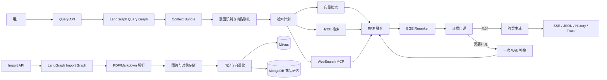

# ProductDoc-Agentic-RAG

面向产品文档问答的 Agentic RAG 项目，覆盖文档导入、结构化检索、多轮上下文、证据自评和流式回答。

项目以 FastAPI 提供服务，以 LangGraph 编排有状态工作流，以 Milvus、MongoDB 和 MinIO 组成知识库基础设施。代码重点展示 AI 应用从“调用模型”走向“可观测、可恢复、可评估”的工程化设计。

## 项目概览

面向读者：招聘方用于快速了解项目价值，技术面试官用于定位核心实现，开发者用于本地启动和扩展。

核心能力：

- 双工作流设计：文档导入图负责构建知识库，查询图负责完成 Agentic RAG 问答。
- 上下文管理：将历史消息、已确认商品、最近证据、答案摘要和待澄清事项整理为结构化 `context_bundle`。
- 工具选择：根据查询意图和时效性选择本地向量检索、HyDE 检索和 WebSearch MCP。
- 证据处理：使用 RRF 融合多路召回结果，再通过 BGE Reranker 进行精排。
- Agent Loop：自评证据充分性，必要时触发一次联网补搜，再回到融合、重排和自评流程。
- 可靠执行：文件内容哈希生成稳定 `doc_id`，Redis 分布式锁抑制重复导入，RQ 提供可选后台队列，SQLite Checkpoint 支持图状态持久化。
- 可观测性：记录路由决策、工具调用、召回数量、重排结果、自评状态、Checkpoint 和耗时 Trace。

## 架构与数据流



### 文档导入链路

```text
Upload API
  → SHA-256 doc_id
  → Redis upload lock（可选）
  → PDF/Markdown 解析
  → 图片上传 MinIO
  → 标题语义切分
  → 商品名称识别
  → BGE-M3 向量化
  → Milvus collection
```

`doc_id` 由文件内容生成。同一份文件在文件名变化后仍然保持相同标识，便于去重、追踪和后续重建索引。

### 查询链路

```text
Query API
  → session memory / history
  → context_bundle
  → query intent
  → item confirmation
  → retrieval plan
  → embedding + HyDE + Web 并行召回
  → RRF + BGE Reranker
  → self-evaluation
  → optional Web retry
  → answer + evidence + trace
```

## 核心模块

| 模块 | 工程价值 | 主要实现 |
| --- | --- | --- |
| Agent Loop | 把单次生成变成可控的“计划—执行—检查—补充”闭环 | [`main_graph.py`](app/query_process/agent/main_graph.py)、[`node_self_eval.py`](app/query_process/agent/nodes/node_self_eval.py)、[`node_retry_web.py`](app/query_process/agent/nodes/node_retry_web.py) |
| 上下文管理 | 控制多轮对话输入规模，保留对当前问题真正有用的信息 | [`node_build_context.py`](app/query_process/agent/nodes/node_build_context.py)、[`state.py`](app/query_process/agent/state.py) |
| 短期与长期记忆 | 分离会话记忆与商品级经验，支持指代消解和检索策略复用 | [`mongo_session_memory_utils.py`](app/clients/mongo_session_memory_utils.py)、[`mongo_product_memory_utils.py`](app/clients/mongo_product_memory_utils.py) |
| Tool Calling | 让模型负责工具选择，代码负责工具边界和结果归一 | [`node_retrieval_plan.py`](app/query_process/agent/nodes/node_retrieval_plan.py)、[`node_web_search_mcp.py`](app/query_process/agent/nodes/node_web_search_mcp.py) |
| RAG 检索 | 组合本地知识、查询扩展和时效信息，提升召回覆盖率 | [`node_search_embedding.py`](app/query_process/agent/nodes/node_search_embedding.py)、[`node_search_embedding_hyde.py`](app/query_process/agent/nodes/node_search_embedding_hyde.py)、[`node_rrf.py`](app/query_process/agent/nodes/node_rrf.py)、[`node_rerank.py`](app/query_process/agent/nodes/node_rerank.py) |
| HITL 澄清 | 商品型号存在歧义时保留待澄清状态，让下一轮对话继续完成确认 | [`node_item_name_confirm.py`](app/query_process/agent/nodes/node_item_name_confirm.py)、[`mongo_session_memory_utils.py`](app/clients/mongo_session_memory_utils.py) |
| 可靠导入 | 通过稳定 ID、分布式锁、后台队列和状态轮询支撑长任务 | [`file_hash_utils.py`](app/utils/file_hash_utils.py)、[`redis_lock_utils.py`](app/utils/redis_lock_utils.py)、[`import_queue.py`](app/utils/import_queue.py) |
| Checkpoint 与 Trace | 保存工作流状态，记录可复盘的决策链路 | [`checkpoint_config.py`](app/conf/checkpoint_config.py)、[`query_trace_utils.py`](app/utils/query_trace_utils.py) |
| 评测 | 按路由、商品确认、检索、答案、自评和重试拆分质量维度 | [`eval/README.md`](eval/README.md)、[`scripts/eval_comprehensive.py`](scripts/eval_comprehensive.py) |

## 工程设计亮点

### 状态图替代隐式调用链

查询流程通过 `QueryGraphState` 传递结构化状态，每个节点只负责一个清晰阶段。路由、检索、排序、自评和回答都能单独观测，新增策略时只需要扩展节点和边。

导入流程使用独立的 `ImportGraphState`，把文件路径、解析结果、切片和向量化结果串成可追踪的数据流。导入图采用懒加载，服务启动时保持轻量，首次执行任务时再初始化重依赖。

### 记忆与上下文分层

- Session Memory 保存最近确认的商品、待澄清任务、最近证据和答案摘要。
- Product Memory 保存标准商品、别名、关联文档和高频问题模式。
- `context_bundle` 在每一轮查询开始时统一组装，后续节点读取稳定结构，减少跨模块拼接字符串。

### 检索与 Agent Loop

`node_retrieval_plan` 输出三个工具开关：本地向量检索、HyDE 检索和 WebSearch。多个分支并行执行，`node_rrf` 做名次融合，`node_rerank` 进行语义精排。

`node_self_eval` 根据问题、召回证据和当前重试次数判断证据是否充分。`insufficient_retry` 只允许触发一次 Web 补搜，补搜结果重新进入 RRF、Rerank 和自评，形成有上限的 Agent Loop。

### 幂等、并发与失败恢复

- 文件内容哈希生成稳定 `doc_id`，将导入幂等键从文件名提升到内容层。
- Redis `SET NX` + TTL 形成上传锁，同一文档的并发导入共享已有任务状态。
- RQ 以 `import:{task_id}` 作为 job ID；Redis 或 Worker 不可用时回退 FastAPI BackgroundTasks，保留本地开发路径。
- 每个查询节点执行前后更新运行状态，Checkpoint 使用 `thread_id=session_id` 关联同一会话。
- Trace 使用 JSONL 追加写入，记录路由、召回、重排、自评、重试、Checkpoint 和耗时摘要。

这些边界让长耗时任务、外部服务抖动和多轮追问都具备清晰的状态入口，便于继续接入更强的队列、数据库事务和分布式观测系统。

## API 入口

### Query Service：端口 8001

启动文件：[`app/query_process/api/query_service.py`](app/query_process/api/query_service.py)

| 方法 | 路径 | 用途 |
| --- | --- | --- |
| `GET` | `/health` | 服务健康检查 |
| `POST` | `/query` | 同步或异步提交问题 |
| `GET` | `/stream/{session_id}` | 通过 SSE 获取流式进度与答案 |
| `GET` | `/history/{session_id}` | 获取会话历史 |
| `DELETE` | `/history/{session_id}` | 清理会话历史与会话记忆 |
| `GET` | `/chat.html` | 打开查询页面 |

同步查询示例：

```bash
curl -X POST http://127.0.0.1:8001/query \
  -H "Content-Type: application/json" \
  -d '{"query":"如何配置产品的上网方式？","is_stream":false}'
```

流式查询先提交：

```bash
curl -X POST http://127.0.0.1:8001/query \
  -H "Content-Type: application/json" \
  -d '{"query":"如何排查设备无法联网？","is_stream":true}'
```

响应中的 `session_id` 可用于订阅：

```bash
curl -N http://127.0.0.1:8001/stream/<session_id>
```

### Import Service：端口 8000

启动文件：[`app/import_process/api/file_import_service.py`](app/import_process/api/file_import_service.py)

| 方法 | 路径 | 用途 |
| --- | --- | --- |
| `GET` | `/health` | 服务健康检查 |
| `POST` | `/upload` | 批量上传 PDF/Markdown 文档 |
| `GET` | `/status/{task_id}` | 查询导入任务状态和阶段进度 |
| `GET` | `/import.html` | 打开文档导入页面 |

上传示例：

```bash
curl -X POST http://127.0.0.1:8000/upload \
  -F "files=@path/to/manual.pdf"
```

## 本地启动

### 1. 准备环境

- Python 3.11+
- [`uv`](https://docs.astral.sh/uv/)
- Milvus
- MongoDB
- MinIO
- OpenAI 兼容模型服务
- 可选：Redis、RQ Worker、MinerU API、WebSearch MCP

安装依赖：

```bash
uv sync
```

### 2. 配置环境变量

复制模板并填写本地服务地址与密钥：

```bash
copy .env.example .env
```

`.env` 已加入 Git 忽略规则。公开仓库只保留脱敏后的 [`.env.example`](.env.example) 模板，密钥、数据库连接串、模型路径和服务地址均通过环境变量注入。

### 3. 启动基础设施

Milvus 依赖 etcd 和 MinIO：

```bash
docker compose -f milvus/docker-compose.yml up -d
```

Redis 为可选组件：

```bash
docker compose -f docker-compose.redis.yml up -d
```

### 4. 启动服务

在两个终端分别运行：

```bash
uv run python -m app.import_process.api.file_import_service
```

```bash
uv run python -m app.query_process.api.query_service
```

浏览器访问：

- 查询页面：<http://127.0.0.1:8001/chat.html>
- 导入页面：<http://127.0.0.1:8000/import.html>
- Query Swagger：<http://127.0.0.1:8001/docs>
- Import Swagger：<http://127.0.0.1:8000/docs>

首次导入前，需要准备 BGE-M3 与 BGE Reranker 模型，并将路径写入 `.env`。WebSearch、MinerU 和模型服务属于可插拔的外部依赖，按需启用即可。

### 5. 启动 RQ Worker（可选）

当 `.env` 中设置 `RQ_ENABLED=True` 且 Redis 已启动时运行：

```bash
uv run python -m app.import_process.worker
```

## 配置分组

`.env.example` 按职责组织变量，常用配置如下：

| 分组 | 关键变量 | 作用 |
| --- | --- | --- |
| LLM | `OPENAI_API_KEY`、`OPENAI_BASE_URL`、`LLM_DEFAULT_MODEL` | OpenAI 兼容模型访问 |
| 解析 | `MINERU_BASE_URL`、`MINERU_API_TOKEN` | PDF/复杂文档解析服务 |
| Embedding | `BGE_M3_PATH`、`BGE_DEVICE`、`BGE_FP16` | 本地向量模型 |
| Reranker | `BGE_RERANKER_LARGE`、`BGE_RERANKER_DEVICE` | 召回结果精排 |
| Vector DB | `MILVUS_URL`、`CHUNKS_COLLECTION`、`ITEM_NAME_COLLECTION` | 切片和商品名称索引 |
| Document DB | `MONGO_URL`、`MONGO_DB_NAME` | 历史、会话记忆和商品记忆 |
| Object Storage | `MINIO_ENDPOINT`、`MINIO_ACCESS_KEY`、`MINIO_SECRET_KEY` | 原始文件和图片存储 |
| Agent | `CHECKPOINT_ENABLED`、`QUERY_TRACE_PATH` | 状态恢复和 Trace 输出 |
| Async jobs | `REDIS_*`、`RQ_*` | 任务状态、上传锁和后台队列 |

## 评测与观测

项目将质量拆成可定位的维度：查询路由、商品确认、文档需求路由、检索计划、证据命中、答案质量、自评准确性和重试效果。

评测脚本支持：

- 路由冒烟：`python scripts/eval_routing.py --intent-only`
- 综合评测：`python scripts/eval_comprehensive.py --dimensions routing,retrieval,answer`
- 消融分析：`python scripts/eval_ablation.py --variants core`
- Trace 汇总：`python scripts/analyze_trace_metrics.py --input logs/*.json`
- Agent 行为验证：`python scripts/verify_agentic.py`

本地验证集和生成报告属于运行时数据，默认放在 `eval/*.jsonl` 与 `logs/`，不会进入公开仓库。使用自有数据集时，通过 `--dataset` 传入路径。

查询 Trace 默认写入 `logs/query_trace.jsonl`，可用于分析：

- 各路由和检索计划的分布
- 各召回分支的结果数量
- RRF 与 Rerank 后的证据变化
- 自评状态与 Web 重试次数
- Checkpoint 覆盖情况
- 查询总耗时及后续 P50/P95 统计

## 项目结构

```text
.
├── app/
│   ├── conf/                 # 环境变量驱动的配置
│   ├── clients/              # Milvus、MongoDB、MinIO、Redis 客户端
│   ├── import_process/       # 文档导入图与导入 API
│   ├── query_process/        # 查询图、Agent 节点与 Query API
│   ├── lm/                   # LLM、Embedding、Reranker 封装
│   ├── tool/                 # 模型下载等辅助工具
│   └── utils/                # 任务状态、锁、队列、Trace 等基础能力
├── prompts/                  # 可版本化的提示词模板
├── scripts/                  # 评测、分析与验证脚本
├── eval/                     # 评测说明与本地验证约定
├── milvus/                   # Milvus 本地部署编排
├── docker-compose.redis.yml  # Redis 本地部署编排
├── .env.example              # 脱敏环境变量模板
├── pyproject.toml            # 项目元数据与依赖
└── uv.lock                   # 可复现依赖锁定
```

## 技术选型

| 技术 | 选择理由 |
| --- | --- |
| FastAPI | 提供轻量 API、SSE 和自动化 Swagger 文档 |
| LangGraph | 用显式状态和边表达 Agent 路由、并行分支、重试与 Checkpoint |
| LangChain | 统一 LLM、消息和检索组件接口 |
| BGE-M3 + BGE Reranker | 组合高覆盖召回与精排能力，适合产品手册场景 |
| Milvus | 承载大规模文档切片向量和商品名称索引 |
| MongoDB | 保存会话历史、会话记忆和商品级长期记忆 |
| MinIO | 保存原始文件和文档图片 |
| Redis + RQ | 为长耗时导入任务提供可选的共享状态与异步队列 |
| SQLite Checkpoint | 为本地开发和单实例部署提供低成本状态恢复 |

## 工程化路线

当前代码边界已经为后续演进预留了清晰位置：

- 将 Checkpoint 从本地 SQLite 迁移到共享存储，支持多实例协作。
- 为模型、MCP 和数据库客户端补充统一超时、退避重试和熔断策略。
- 在 API 网关层加入鉴权、限流和租户隔离。
- 将 JSONL Trace 接入 OpenTelemetry 或集中式日志平台。
- 持续扩充脱敏验证集，比较 Recall@K、证据命中率、答案通过率与 P50/P95 延迟。

## 许可与使用

仓库中的示例代码用于展示 Agentic RAG 应用的工程组织方式。使用外部模型、解析服务和文档数据时，请遵守相应服务条款与数据授权要求。
